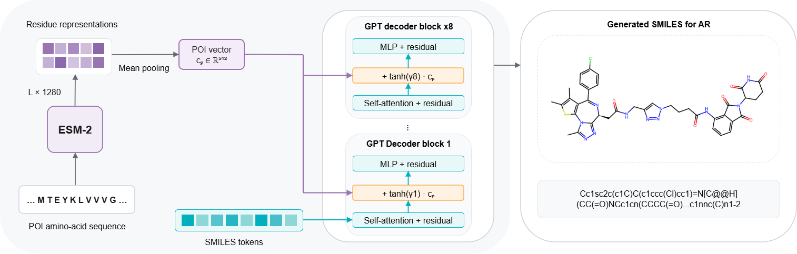

# TACFormer

TACFormer is a decoder-only transformer for PROTAC SMILES generation. The same molecular decoder backbone is used in three stages:

1. **Pretraining** on PROTAC-like molecules.
2. **Unconditional fine-tuning** on PROTAC SMILES.
3. **POI-conditional fine-tuning** on PROTAC SMILES conditioned on protein-of-interest (POI) embeddings from ESM-2.

## Architecture overview



In the conditional model, the POI amino-acid sequence is encoded with ESM-2, mean pooled into a POI vector, and injected into every GPT decoder block while the model autoregressively generates SMILES tokens.

## Repository entry points

Training, generation, and evaluation use the same entry points, with different YAML configuration files:
```text
scripts/train.py
scripts/generate.py
scripts/evaluate.py
```

All commands below run directly with Python. 

## Environment

The original experiments used an Apptainer container based on `nvcr.io/nvidia/pytorch:26.04-py3`. For a local environment, first install a version of PyTorch compatible with your system, then install the additional packages:

```bash
python -m venv .venv
source .venv/bin/activate

# Install PyTorch separately for your system.
python -m pip install \
  "rdkit>=2024.3.1" \
  "optuna>=4.8" \
  "seaborn>=0.13" \
  "tqdm>=4.67" \
  "transformers>=4.48.0" \
  "accelerate>=1.3.0"

export TOKENIZERS_PARALLELISM=false
```

GPU training and generation require a working CUDA-compatible PyTorch installation.

## Configuration files

The code is configured through YAML files.

| Stage | Training config | Generation config | Evaluation config |
| --- | --- | --- | --- |
| Unconditional | `configs/unconditional/train.yaml` | `configs/unconditional/generate.yaml` | `configs/unconditional/evaluate.yaml` |
| Conditional, seen POIs | `configs/conditional/trainv3.yaml` | `configs/conditional/generate.yaml` | `configs/conditional/evaluate.yaml` |
| Conditional, unseen POIs | same trained model | `configs/conditional/generate_unseen.yaml` | `configs/conditional/evaluate.yaml` with overrides |

Override the paths on the command line instead of editing the files.

Example:

```bash
python -u scripts/train.py \
  --config configs/unconditional/train.yaml \
  --override \
    model.init_checkpoint="/path/to/pretrained/checkpoint" \
    data.train_jsonl="/path/to/train.jsonl" \
    data.val_jsonl="/path/to/val.jsonl" \
    train.output_dir="/path/to/output"
```

Common path keys to override:

- `model.init_checkpoint`
- `model.path`
- `data.train_jsonl`
- `data.val_jsonl`
- `conditioning.poi_embeddings_path`
- `generation.output_path`
- `evaluation.generated_jsonl`
- `evaluation.reference_train_jsonl`
- `evaluation.test_jsonl`
- `evaluation.output_dir`
- `tokenizer.path`

## Training

### Pretraining

Pretraining produces the checkpoint used to initialize both fine-tuning stages.

```bash
export PRETRAIN_CKPT="/path/to/pretraining/checkpoint"
```

### Unconditional fine-tuning

Train the unconditional model with training seed `42`.

```bash
export RUNS_DIR="$PWD/runs"
export PRETRAIN_CKPT="/path/to/pretraining/checkpoint"

python -u scripts/train.py \
  --config configs/unconditional/train.yaml \
  --override \
    model.init_checkpoint="$PRETRAIN_CKPT" \
    train.seed=42 \
    train.output_dir="$RUNS_DIR/unconditional/seed_42" \
    train.run_name="unconditional_seed_42" \
    train.report_to=none
```

### POI-conditional fine-tuning

Train the conditional model once with training seed `47`.

```bash
python -u scripts/train.py \
  --config configs/conditional/trainv3.yaml \
  --override \
    model.init_checkpoint="$PRETRAIN_CKPT" \
    train.seed=47 \
    train.output_dir="$RUNS_DIR/conditional/seed_47" \
    train.run_name="conditional_seed_47" \
    train.report_to=none
```

The conditional model also requires POI embeddings, configured by `conditioning.poi_embeddings_path`.

## Multi-seed generation

 Generation is repeated with different sampling seeds using the same checkpoint.

The reported generation seeds are:

```text
71, 101, 123
```

### Unconditional generation

```bash
export RUNS_DIR="$PWD/runs"
export MODEL_CKPT="/path/to/unconditional/checkpoint"

for SEED in 71 101 123; do
  OUT_DIR="$RUNS_DIR/unconditional/seed_42/gen_seed_${SEED}"
  mkdir -p "$OUT_DIR"

  python -u scripts/generate.py \
    --config configs/unconditional/generate.yaml \
    --override \
      model.path="$MODEL_CKPT" \
      generation.seed="$SEED" \
      generation.output_path="$OUT_DIR/raw_samples.jsonl"
done
```

### Conditional generation on seen POIs

```bash
export RUNS_DIR="$PWD/runs"
export MODEL_CKPT="/path/to/conditional/checkpoint"

for SEED in 71 101 123; do
  OUT_DIR="$RUNS_DIR/conditional/seed_47/gen_seed_${SEED}"
  mkdir -p "$OUT_DIR"

  python -u scripts/generate.py \
    --config configs/conditional/generate.yaml \
    --override \
      model.path="$MODEL_CKPT" \
      generation.seed="$SEED" \
      generation.output_path="$OUT_DIR/raw_samples.jsonl"
done
```

### Conditional generation on unseen POIs

```bash
export RUNS_DIR="$PWD/runs"
export MODEL_CKPT="/path/to/conditional/checkpoint"

for SEED in 71 101 123; do
  OUT_DIR="$RUNS_DIR/conditional/seed_47/gen_seed_${SEED}/unseen"
  mkdir -p "$OUT_DIR"

  python -u scripts/generate.py \
    --config configs/conditional/generate_unseen.yaml \
    --override \
      model.path="$MODEL_CKPT" \
      generation.seed="$SEED" \
      generation.output_path="$OUT_DIR/raw_samples_unseen.jsonl"
done
```

## Evaluation

### Unconditional evaluation

```bash
export RUNS_DIR="$PWD/runs"

for SEED in 71 101 123; do
  OUT_DIR="$RUNS_DIR/unconditional/seed_42/gen_seed_${SEED}"

  python -u scripts/evaluate.py \
    --config configs/unconditional/evaluate.yaml \
    --override \
      evaluation.seed="$SEED" \
      evaluation.generated_jsonl="$OUT_DIR/raw_samples.jsonl" \
      evaluation.output_dir="$OUT_DIR/evaluation"
done
```

### Conditional evaluation on seen POIs

```bash
export RUNS_DIR="$PWD/runs"
export MODEL_CKPT="/path/to/conditional/checkpoint"

for SEED in 71 101 123; do
  OUT_DIR="$RUNS_DIR/conditional/seed_47/gen_seed_${SEED}"

  python -u scripts/evaluate.py \
    --config configs/conditional/evaluate.yaml \
    --override \
      model.path="$MODEL_CKPT" \
      evaluation.seed="$SEED" \
      evaluation.generated_jsonl="$OUT_DIR/raw_samples.jsonl" \
      evaluation.output_dir="$OUT_DIR/evaluation"
done
```

### Conditional evaluation on unseen POIs

```bash
export RUNS_DIR="$PWD/runs"
export MODEL_CKPT="/path/to/conditional/checkpoint"

for SEED in 71 101 123; do
  OUT_DIR="$RUNS_DIR/conditional/seed_47/gen_seed_${SEED}/unseen"

  python -u scripts/evaluate.py \
    --config configs/conditional/evaluate.yaml \
    --override \
      model.path="$MODEL_CKPT" \
      evaluation.seed="$SEED" \
      evaluation.generated_jsonl="$OUT_DIR/raw_samples_unseen.jsonl" \
      evaluation.test_jsonl="data/processed/conditional_top_20/unseen.jsonl" \
      evaluation.output_dir="$OUT_DIR/evaluation"
done
```

## Directory layout example

```text
runs/
├── unconditional/
│   └── seed_42/
│       ├── checkpoint-xxxxx/
│       ├── gen_seed_71/
│       ├── gen_seed_101/
│       └── gen_seed_123/
└── conditional/
    └── seed_47/
        ├── checkpoint-xxxxx/
        ├── gen_seed_71/
        ├── gen_seed_101/
        └── gen_seed_123/
```

## Notes

- `model.path` should point to a checkpoint directory.
- The tokenizer defaults to `artifacts/tokenizer_pretrain/tokenizer.json`.
- Relative paths are resolved from the repository root.
- Conditional generation and evaluation require `conditioning.poi_embeddings_path`.
- For small test runs, override `generation.num_samples`.
